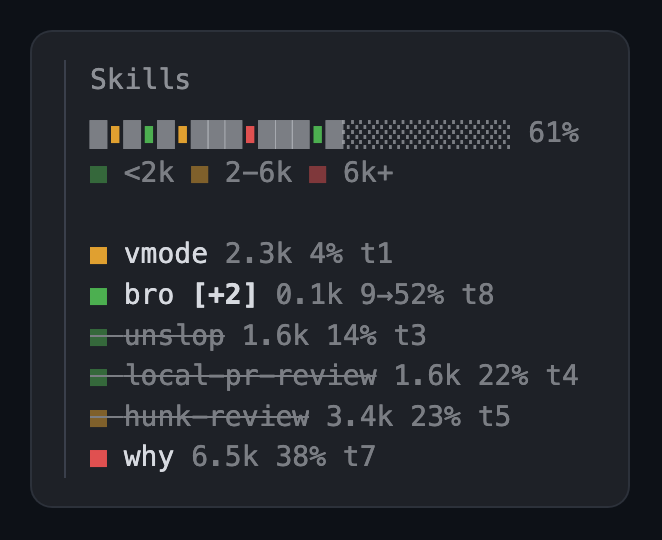

# skill-map



<sub>Drawn by the mod from sample data.</sub>

A side pane listing every skill loaded into the main conversation, one line each. A narrow pane shows the name and size; from 30 columns each line adds the details:

```
■ vmode      2.3k          ■ vmode [+1] 2.3k 4→61% t1
■ apple-des… 5.6k          ■ apple-design 5.6k 9% t3
```

- The square's color is the skill's size: green under 2k tokens, amber 2k to 6k, red 6k and up. Tokens are estimated as characters / 4.
- `[+1]` counts loads that added the skill's text again. Typing `/name` twice does that. Claude Code skips a repeat Skill tool load by itself, so those don't count.
- `4→61%` is how full the context window was at the first and the latest load. `t1` is the turn of the latest load.
- After a compaction, a skill whose text was summarized away turns grey and crossed out.
- The bar on top is the context window, filled to current usage, with a marker where each skill landed.

`/skill-map` opens or closes the pane. `/skill-map reset` clears it. The pane opens by itself on the first skill load. In fullscreen it is a sidebar only: it docks beside the transcript from 110 columns, and on a narrower terminal it waits, undrawn, until the terminal is wide enough. On the main screen, which has no dock, it sits above the prompt at 17 columns. Docked, it opens 17 columns wide (about 145px) and cuts long names with `…`; drag the dock wider and the rows grow to show them whole. A width you drag to is kept in `~/.claude.json` as `pluginPanes.dockColumns` and wins over the 17.

The pane's `✕`, or `/skill-map minimize`, minimizes it to a `[+] skills 8 · 29%` chip on the row above the prompt; click the chip to bring the pane back. While minimized, new skill loads update the chip instead of reopening the pane. `/skill-map` still closes it for good. Mods that draw on that row take turns in the order they load, and the first one wins the row, so load skill-map before them (`CLAUDE_CODE_PLUGIN_DIRS=~/.claude/mods/skill-map:~/.claude/mods/token-weather`) or its chip won't show.

Only the main conversation counts. Skills a subagent loads stay in the subagent's context and are left out.

## Install

```bash
claude plugin marketplace add vuon9/cc-mods
claude plugin install skill-map@cc-mods
```

Update with `claude plugin update skill-map`.

## Limits

- Skill loads are spotted by the line `Base directory for this skill: ...` that Claude Code puts at the top of each one. If a release rewords it, the pane stops picking skills up.
- Reading a `SKILL.md` counts only as a whole file: the Read tool without a line range, or a plain `cat`. `head`, `grep` and piped reads don't.
- Built and tested on Claude Code 2.1.288 to 2.1.292.

## Develop

From the repo root:

```bash
claude --plugin-dir plugins/skill-map
claude plugin test plugins/skill-map
```
