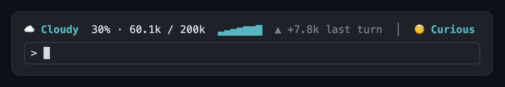

# token-weather



<sub>Drawn by the mod from sample data.</sub>

A one-line forecast of the context window, shown above the prompt and updated after every turn:

```
☁️ Cloudy  30% · 60k / 200k  ▂▃▅▆  ▲ +23.9k last turn  │  Opus 5.5 (high)
```

- The forecast follows how full the window is: Clear under 25%, Cloudy under 50%, Showers under 75%, Storm under 90%, then Compact soon.
- The sparkline is the context size over the last 12 turns. The delta is how much the last turn added or freed.
- Right after a compaction it shows `↺ Compacted` until your next message brings back a real size.
- The end shows the model and effort of the latest request, as it was sent, so a fallback model or a lowered effort shows there. It appears after the first request, and a `/model` or `/effort` change shows from the next one.

Only the main conversation counts; subagent turns don't move it. The mod makes no model calls of its own.

## Install

```bash
claude plugin marketplace add vuon9/cc-mods
claude plugin install token-weather@cc-mods
```

Update with `claude plugin update token-weather`.

## Develop

From the repo root:

```bash
claude --plugin-dir plugins/token-weather
claude plugin test plugins/token-weather
```
